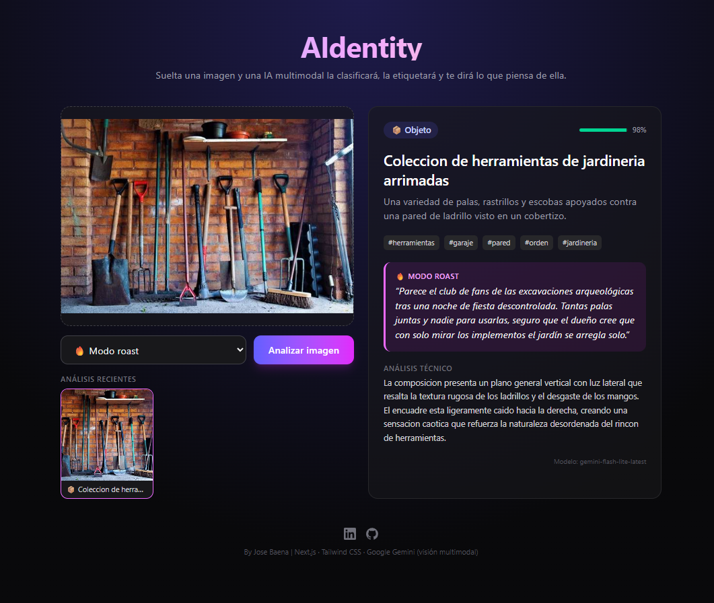

# AIdentity — Clasificador de imágenes con comentarios IA

Arrastra (o pega con Ctrl+V) una foto —un plato de comida, un paisaje, un meme, la captura de un bug— y un modelo de visión multimodal (Google Gemini) la **clasifica**, la **etiqueta** y le añade un **comentario ingenioso** junto a un **análisis técnico**.



## Funcionalidades

- **Drag & drop**, selector de archivo y pegado desde el portapapeles.
- **Salida estructurada**: Gemini devuelve JSON validado contra un esquema (categoría, título, etiquetas, descripción, comentario, análisis técnico y confianza).
- **Selector de tono** que se inyecta en el prompt del sistema: 🎨 crítico de arte, 🔥 roast o 💪 motivacional.
- **Historial** de los 3 últimos análisis, con clic para volver a verlos.
- **Análisis técnico adaptativo**: diagnóstico y posible arreglo si es una captura de un error; composición, luz y encuadre si es una foto.
- **Modelos de respaldo**: si el modelo principal está saturado (503), limitado (429) o tarda demasiado, se prueba automáticamente el siguiente.
- **Compresión en el cliente**: la imagen se redimensiona a 1600 px máx. antes de enviarse, para ir más rápido y gastar menos tokens.

## Stack

- **Next.js** (App Router) + **React 19**
- **Tailwind CSS v4**
- **@google/genai** (SDK oficial de Google Gen AI) con `gemini-3.8-flash`

## Estructura

```
AIdentity/
├── app/
│   ├── api/analizar/route.js  # Endpoint: recibe la imagen, la pasa a base64 y llama a Gemini
│   ├── layout.jsx
│   ├── page.jsx               # UI: drag & drop, selector de tono, resultado e historial
│   └── globals.css
└── lib/tonos.js               # Tonos disponibles (compartido entre cliente y servidor)
```

## Puesta en marcha

1. Instala las dependencias:
   ```bash
   npm install
   ```
2. Copia `.env.local.example` a `.env.local` y pon tu clave de [Google AI Studio](https://aistudio.google.com/apikey):
   ```
   GEMINI_API_KEY=tu_api_key
   GEMINI_MODEL=gemini-3.8-flash   # opcional
   GEMINI_FALLBACK_MODELS=gemini-3.7-flash,gemini-flash-lite-latest   # opcional
   ```
3. Arranca el servidor de desarrollo:
   ```bash
   npm run dev
   ```
4. Abre http://localhost:3000.

## API

`POST /api/analizar` (multipart/form-data)

| Campo    | Tipo   | Descripción                                   |
| -------- | ------ | --------------------------------------------- |
| `imagen` | File   | JPG, PNG, WEBP o HEIC, máx. 4 MB              |
| `tono`   | string | `critico`, `roast` o `motivacional` (opcional) |

Respuesta:

```json
{
  "categoria": "comida",
  "titulo": "Paella con más fe que azafrán",
  "etiquetas": ["paella", "arroz", "cocina española"],
  "descripcion": "Una paellera con arroz, pollo y judías verdes.",
  "comentario": "…",
  "analisisTecnico": "…",
  "confianza": 0.95,
  "tono": "roast",
  "modelo": "gemini-3.8-flash"
}
```
